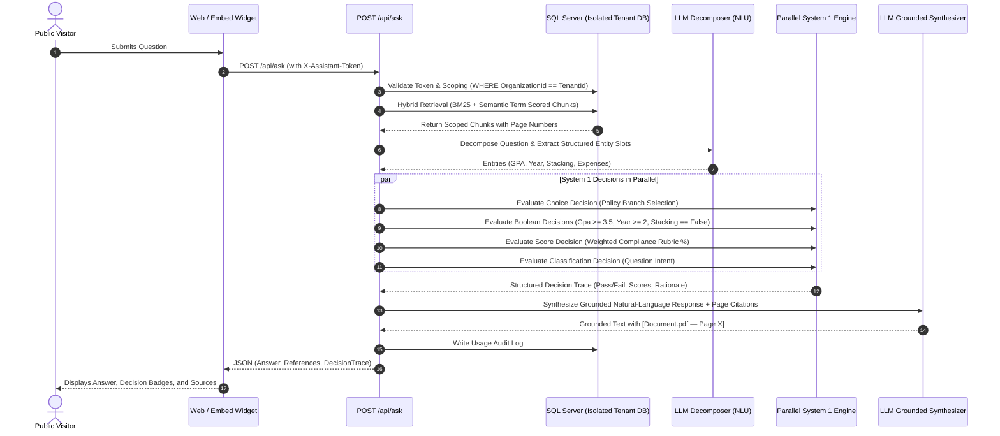

# AI Knowledge & Decision Assistant — Complete Documentation & Credentials

This document provides the full credentials, URLs, architecture specifications, API contracts, test scenarios, and run commands for the multi-tenant SaaS application.

---

## 1. System Credentials & Tenant Access

The application comes pre-configured with two isolated organizations and their respective administrators, assistants, and documents in your local SQL Server database.

### Organization 1: Apex University (Academic & Scholarships)
- **Domain**: Higher Education, Academic Integrity, Grading, Honors & Scholarships
- **Dashboard Login Email**: `admin@apex.edu`
- **Dashboard Password**: `ApexAdmin2026!`
- **Role**: Dean of Academic Affairs
- **Public Assistant Token**: `ast_live_apex_univ_8f93e`
- **Direct Public Assistant URL**: [http://localhost:5084/assistant/ast_live_apex_univ_8f93e](http://localhost:5084/assistant/ast_live_apex_univ_8f93e)
- **Indexed Knowledge Base Documents**:
  1. `Scholarship_and_Honors_Rules.pdf` (5 pages)
     - *Page 1*: Minimum Cumulative GPA 3.50, full-time enrollment requirements.
     - *Page 2*: Section 2.1 Academic Standing (Sophomore / Year 2 standing required; 30 credits min; Freshmen excluded).
     - *Page 3*: Section 3.0 Award Tiers ($8,000 for GPA $\ge 3.85$; $5,000 for GPA 3.50–3.84) & Dean's List.
     - *Page 4*: Section 4.2 Stacking Restrictions & Athletic Exclusions (Cannot stack with active sports scholarships).
     - *Page 5*: Section 5.0 Annual Renewal Process (Maintain 3.40 GPA, petition by May 15).
  2. `Academic_Integrity_and_Grading.pdf` (3 pages)
     - *Page 1*: Letter grade scales (A=4.0 to F=0.0) & Incomplete (I) resolution timeline.
     - *Page 2*: Section 3.4 Grade Appeal Procedure (14 calendar days to Department Chair).
     - *Page 3*: Academic probation threshold (GPA < 2.00) & course retake limit (max 2 repeats).

---

### Organization 2: FinTech Global Solutions (Corporate Operations)
- **Domain**: Financial Services, Remote Work, Hardware Stipends, Corporate Travel & Expenses
- **Dashboard Login Email**: `admin@fintechglobal.com`
- **Dashboard Password**: `FinTechAdmin2026!`
- **Role**: Global Operations Director
- **Public Assistant Token**: `ast_live_fintech_glob_4c21b`
- **Direct Public Assistant URL**: [http://localhost:5084/assistant/ast_live_fintech_glob_4c21b](http://localhost:5084/assistant/ast_live_fintech_glob_4c21b)
- **Indexed Knowledge Base Documents**:
  1. `Remote_Work_and_Equipment_Policy.pdf` (4 pages)
     - *Page 1*: Hybrid vs Full Remote classifications.
     - *Page 2*: Section 2.2 Tenure Requirement (Minimum 6 continuous months tenure required).
     - *Page 3*: Section 3.1 Home Office Setup Stipend ($1,200.00 every 24 months for desks, monitors, peripherals).
     - *Page 4*: Section 4.3 International Remote Work Limit (Max 30 calendar days per year; 14-day clearance rule).
  2. `Travel_and_Expense_Guidelines.pdf` (3 pages)
     - *Page 1*: Section 1.2 Per Diem Meal Allowance ($75.00/full day; alcohol non-reimbursable).
     - *Page 2*: Section 2.4 Airfare Standards (Domestic flights < 5 hrs Economy; Business class only for international non-stop > 8 hrs).
     - *Page 3*: Section 3.2 Pre-Approval Cap (Expenses > $1,000 mandate written manager pre-approval; $25 receipt rule).

---

## 2. Local Database & Scaffolding Details

- **Database Engine**: Microsoft SQL Server 2022 Express Edition
- **Instance**: `LAPTOP-BT9E70FJ\SQLEXPRESS`
- **Database Name**: `AIKnowledgeAssistant`
- **Connection String**:
  ```
  Server=LAPTOP-BT9E70FJ\SQLEXPRESS;Database=AIKnowledgeAssistant;MultipleActiveResultSets=True;Trusted_Connection=True;TrustServerCertificate=True;
  ```
- **Database Tables Verified**:
  - `[Organizations]` (2 seeded rows)
  - `[Users]` (2 seeded rows)
  - `[Assistants]` (2 seeded rows)
  - `[Documents]` (4 seeded rows)
  - `[DocumentChunks]` (15 indexed chunks)
  - `[UsageLogs]` (2 audit log rows)
- **Scaffolded EF Core Models**:
  Available in `AIKnowledgeAssistant.Web/Models/` and `AIKnowledgeAssistant.Infrastructure/Models/`:
  - `AiknowledgeAssistantContext.cs`
  - `Organization.cs`
  - `User.cs`
  - `Assistant.cs`
  - `Document.cs`
  - `DocumentChunk.cs`
  - `UsageLog.cs`

---

## 3. Web Navigation & URLs

| Portal / View | Local URL | Description | Auth Required? |
| :--- | :--- | :--- | :--- |
| **Login Page** | `http://localhost:5084/Account/Login` | Organization login with 1-click test login buttons | No |
| **Registration** | `http://localhost:5084/Account/Register` | Register a new organization tenant | No |
| **Admin Dashboard** | `http://localhost:5084/Dashboard` | Metrics, quota bar, token regeneration, live playground | Yes (Cookie Auth) |
| **Document Manager** | `http://localhost:5084/Documents` | Upload PDFs (limit validated), view chunks, delete | Yes (Cookie Auth) |
| **Public Chat (Apex)** | `http://localhost:5084/assistant/ast_live_apex_univ_8f93e` | Public assistant chat for Apex University | No (Public Visitor) |
| **Public Chat (FinTech)**| `http://localhost:5084/assistant/ast_live_fintech_glob_4c21b` | Public assistant chat for FinTech Global | No (Public Visitor) |
| **Third-Party Embed Demo**| `http://localhost:5084/embed_demo.html` | Simulated external webpage showing iframe/widget embedding | No (Public Demo) |
| **5-Min Video Walkthrough**| `http://localhost:5084/demo_presentation.html` | Interactive 5-minute video walkthrough player with voiceover | No (Public Demo) |
| **Public Ask API** | `POST http://localhost:5084/api/ask` | Backend REST endpoint for AI answers & decisions | Via Assistant Token |

---

## 4. Question Processing Pipeline: LLM + System 1 Architecture



---

## 5. Mandatory Limits Enforcement

Mandatory SaaS limits are enforced server-side:

1. **Maximum 10 PDF Documents per Organization**:
   - Monitored on dashboard with visual progress bar.
   - When 10 documents exist, the 11th upload is rejected with HTTP 400:
     `"Upload limit reached: Organization already has 10 documents. The mandatory maximum limit is 10 PDF documents."`
2. **Maximum 20 Pages per PDF Document**:
   - `PdfPig` counts pages on upload; files $> 20$ pages return HTTP 400:
     `"Document contains X pages, which exceeds the mandatory limit of 20 pages per PDF."`
3. **Maximum 10 MB File Size per PDF**:
   - Files $> 10$ MB ($10,485,760$ bytes) return HTTP 400:
     `"File size limit exceeded: The uploaded file is X MB. The mandatory maximum limit is 10 MB per PDF."`

Sample files for testing limits are located in `sample_data/`:
- `Apex_University_Scholarship_and_Honors_Rules.pdf` (5 pages - Valid)
- `Apex_University_Academic_Integrity_and_Grading.pdf` (3 pages - Valid)
- `FinTech_Remote_Work_and_Equipment_Policy.pdf` (4 pages - Valid)
- `FinTech_Travel_and_Expense_Guidelines.pdf` (3 pages - Valid)
- `Test_Oversized_22_Pages.pdf` (22 pages - Rejection test file)

---

## 6. Complete Test Questions Matrix & Demo Script

These 12 scenarios verify all question categories mandated by the evaluation criteria:

### Apex University Scenarios (Token: `ast_live_apex_univ_8f93e`)

#### Q1: Direct Information
- **Question**: `"What is the minimum cumulative GPA required for Tier A Merit Honors?"`
- **Category**: `DirectInformation`
- **System 1 & LLM Result**: Tier A Merit Honors requires cumulative GPA of **3.85 or higher** (Annual stipend: $8,000).
- **Source Citation**: `Scholarship_and_Honors_Rules.pdf — Page 3`

#### Q2: Policy Query
- **Question**: `"Are first-year freshman students eligible for university merit scholarships?"`
- **Category**: `PolicyQuery`
- **System 1 & LLM Result**: **No**. Section 2.1 requires applicants to be of Sophomore standing (Year 2 or above, minimum 30 earned semester credits).
- **Source Citation**: `Scholarship_and_Honors_Rules.pdf — Page 2`

#### Q3: Procedural Query
- **Question**: `"What is the procedure and timeline for filing a formal grade appeal?"`
- **Category**: `ProceduralQuery`
- **System 1 & LLM Result**: Informal discussion within 7 days; formal written appeal to Department Chair within **14 calendar days** of grade posting.
- **Source Citation**: `Academic_Integrity_and_Grading.pdf — Page 2`

#### Q4: Multi-Condition Decision (Compound Rejection Scenario)
- **Question**: `"I am a 3rd year student with a 3.7 GPA and an active sports scholarship. Am I eligible for a merit scholarship?"`
- **Category**: `MultiConditionDecision`
- **System 1 Decision Engine Breakdown**:
  - `MinimumGpaRequirement` [GPA $\ge 3.50$]: **PASSED** (3.7 satisfies threshold)
  - `AcademicYearRequirement` [Year $\ge 2$]: **PASSED** (Junior satisfies requirement)
  - `StackingProhibitionRule` [Section 4.2]: **FAILED** (Sports scholarship stacking prohibited)
  - `OverallEligibility`: **INELIGIBLE / REJECTED**
  - `SupportScore`: **66.7%** (2 of 3 conditions satisfied)
- **Source Citation**: `Scholarship_and_Honors_Rules.pdf — Page 4`

#### Q5: Multi-Condition Decision (Approval Scenario)
- **Question**: `"I am a 3rd year student with a 3.9 GPA and no athletic stipend. Am I eligible for a merit scholarship?"`
- **Category**: `MultiConditionDecision`
- **System 1 Decision Engine Breakdown**:
  - `MinimumGpaRequirement`: **PASSED** (3.9 $\ge$ 3.5)
  - `AcademicYearRequirement`: **PASSED** (3 $\ge$ 2)
  - `StackingProhibitionRule`: **PASSED** (no athletic award)
  - `OverallEligibility`: **ELIGIBLE / APPROVED**
  - `SupportScore`: **100%**
- **Source Citation**: `Scholarship_and_Honors_Rules.pdf — Page 3`

#### Q6: Comparison
- **Question**: `"What is the difference between Tier A and Tier B merit scholarships?"`
- **Category**: `Comparison`
- **System 1 & LLM Result**: Tier A is $8,000/year for GPA $\ge 3.85$; Tier B is $5,000/year for GPA 3.50–3.84.
- **Source Citation**: `Scholarship_and_Honors_Rules.pdf — Page 3`

#### Q7: Out-of-Knowledge-Base
- **Question**: `"What is the capital of Australia?"`
- **Category**: `OutOfKnowledgeBase`
- **System 1 & LLM Result**: Grounding check indicates zero relevant context. The assistant does not invent an answer and informs the user that the knowledge base lacks information.
- **Citations**: None (0 references returned)

---

### FinTech Global Solutions Scenarios (Token: `ast_live_fintech_glob_4c21b`)

#### Q8: Direct Information
- **Question**: `"What is the daily per diem meal allowance for business travel?"`
- **Category**: `DirectInformation`
- **System 1 & LLM Result**: **$75.00 USD/day** for full travel days ($50.00 on departure/arrival). Personal alcohol is strictly non-reimbursable.
- **Source Citation**: `Travel_and_Expense_Guidelines.pdf — Page 1`

#### Q9: Policy Query
- **Question**: `"When is business class air travel permitted?"`
- **Category**: `PolicyQuery`
- **System 1 & LLM Result**: Business class is permitted **only for nonstop international flights exceeding 8 continuous hours**. Domestic flights under 5 hours must be Economy.
- **Source Citation**: `Travel_and_Expense_Guidelines.pdf — Page 2`

#### Q10: Multi-Condition Decision (Approved Remote Work Stipend)
- **Question**: `"Can I receive the $1200 home office stipend if I have been with the company for 8 months?"`
- **Category**: `MultiConditionDecision`
- **System 1 Decision Engine Breakdown**:
  - `RemoteWorkMinimumTenure` [Tenure $\ge 6$ mos]: **PASSED** (8 months $\ge$ 6 months)
  - `HomeOfficeStipendAllowance` [Amount $\le \$1,200$]: **PASSED** ($1,200 satisfies cap)
  - `OverallEligibility`: **ELIGIBLE / APPROVED**
  - `SupportScore`: **100%**
- **Source Citation**: `Remote_Work_and_Equipment_Policy.pdf — Page 3`

#### Q11: Multi-Condition Decision (Pre-Approval Restriction)
- **Question**: `"Can I book a $1500 conference flight without manager pre-approval?"`
- **Category**: `MultiConditionDecision`
- **System 1 Decision Engine Breakdown**:
  - `ExpensePreApprovalCap` [Amount $\le \$1,000$ without approval]: **FAILED** ($1,500 exceeds $1,000 limit)
  - `OverallEligibility`: **RESTRICTION APPLIES / FAILED**
  - `Summary`: Mandates written pre-approval from Department VP prior to booking.
- **Source Citation**: `Travel_and_Expense_Guidelines.pdf — Page 3`

#### Q12: Out-of-Knowledge-Base
- **Question**: `"What is the recipe for chicken parmesan?"`
- **Category**: `OutOfKnowledgeBase`
- **System 1 & LLM Result**: No relevant corporate documents found. Grounding fails cleanly with standard out-of-domain notification.

---

## 7. Major API Contract: `POST /api/ask`

### Request
```http
POST /api/ask HTTP/1.1
Host: localhost:5084
Content-Type: application/json
X-Assistant-Token: ast_live_apex_univ_8f93e

{
  "question": "I am a 3rd year student with a 3.7 GPA and an active sports scholarship. Am I eligible for a merit scholarship?"
}
```

### Response
```json
{
  "success": true,
  "data": {
    "answer": "### Decision Result: **NOT ELIGIBLE / RESTRICTION APPLIES**\n\nBased on our structured policy assessment under **Merit Scholarship and Honors**, the application cannot be approved in its current state (Compliance Score: **66.7%**).\n\n#### Policy Evaluation Breakdown:\n- ✅ **Cumulative GPA Threshold** [PASSED]: Extracted 3.7 satisfies requirement (>= 3.5).\n- ✅ **Minimum Standing / Academic Year** [PASSED]: Extracted 3 satisfies requirement (>= 2).\n- ❌ **Athletic Award Stacking Exclusion (Section 4.2)** [FAILED]: Section 4.2 strictly prohibits concurrent stacking of Merit Scholarships with active Athletic/Sports awards.\n\n---\n#### Sources & Document References:\n- 📄 `Scholarship_and_Honors_Rules.pdf — Page 4`",
    "intent": 4,
    "intentDescription": "Query requires evaluating conditional parameters against policy rules.",
    "isGrounded": true,
    "requiresHumanReview": false,
    "responseTimeMs": 95.0,
    "references": [
      {
        "documentName": "Scholarship_and_Honors_Rules.pdf",
        "pageNumber": 4,
        "excerpt": "APEX UNIVERSITY SCHOLARSHIP RULES - SECTION 4.2: STACKING RESTRICTIONS & ATHLETIC EXCLUSIONS...",
        "relevanceScore": 1.45,
        "formattedCitation": "Scholarship_and_Honors_Rules.pdf — Page 4"
      }
    ],
    "decisionTrace": {
      "overallEligibility": false,
      "summary": "INELIGIBLE / REJECTED: 1 of 3 conditions failed under 'Merit_Scholarship_and_Honors'. Reasons: StackingProhibitionRule failed. Support Score: 67%.",
      "appliedPolicyCategory": "Merit_Scholarship_and_Honors",
      "supportScore": 0.667,
      "decisions": [
        {
          "type": 4,
          "name": "QuestionIntentClassification",
          "resultValue": "MultiConditionDecision",
          "isPassed": true,
          "rationale": "Classified as MultiConditionDecision based on syntactic patterns and entity requirements."
        },
        {
          "type": 1,
          "name": "PolicyBranchSelection",
          "resultValue": "Merit_Scholarship_and_Honors",
          "isPassed": true,
          "rationale": "Selected policy framework 'Merit_Scholarship_and_Honors'."
        },
        {
          "type": 2,
          "name": "MinimumGpaRequirement",
          "resultValue": "Passed",
          "isPassed": true,
          "rationale": "Extracted 3.7 satisfies requirement (>= 3.5)."
        },
        {
          "type": 2,
          "name": "AcademicYearRequirement",
          "resultValue": "Passed",
          "isPassed": true,
          "rationale": "Extracted 3 satisfies requirement (>= 2)."
        },
        {
          "type": 2,
          "name": "StackingProhibitionRule",
          "resultValue": "Failed",
          "isPassed": false,
          "rationale": "Boolean flag does not match requirement (got true, required false)."
        },
        {
          "type": 3,
          "name": "PolicyComplianceScore",
          "resultValue": "66.7%",
          "score": 0.667,
          "isPassed": false,
          "rationale": "2 of 3 conditions met. Score: 66.7%."
        }
      ]
    }
  }
}
```

---

## 8. Run & Verification Commands

### 1. Run All Automated Tests (20 of 20 Tests Passing)
```powershell
dotnet test AIKnowledgeAssistant.Tests\AIKnowledgeAssistant.Tests.csproj
```

### 2. Start the Live Application
```powershell
dotnet run --project AIKnowledgeAssistant.Web\AIKnowledgeAssistant.Web.csproj
```

---

## 9. Modular Dependency Injection & AutoMapper Architecture

The project cleanly isolates all dependency injection and mapper registrations outside of `Program.cs` into modular extension methods matching the enterprise `ServicesConfiguration` pattern:

### 1. `AIKnowledgeAssistant.Application/ServicesConfiguration.cs`
Registers AutoMapper profile and singleton `IMapper`:
```csharp
using AutoMapper;
using AIKnowledgeAssistant.Application.Mapping;
using Microsoft.Extensions.Configuration;
using Microsoft.Extensions.DependencyInjection;

namespace AIKnowledgeAssistant.Application;

public static class ServicesConfiguration
{
    public static IServiceCollection AddApplicationServices(this IServiceCollection services, IConfiguration? configuration = null)
    {
        var mappingConfig = new MapperConfiguration(mc =>
        {
            mc.AddProfile(new MappingProfile());
        });
        IMapper mapper = mappingConfig.CreateMapper();
        services.AddSingleton(mapper);

        return services;
    }
}
```

### 2. `AIKnowledgeAssistant.Infrastructure/ServicesConfiguration.cs`
Registers Database Context (`IApplicationDbContext`), AutoMapper, and all domain & application services:
```csharp
namespace AIKnowledgeAssistant.Infrastructure;

public static class ServicesConfiguration
{
    public static IServiceCollection AddInfrastructureServices(this IServiceCollection services, IConfiguration configuration)
    {
        // 1. Database Context Configuration (SQL Server / SQLite)
        var connectionString = configuration.GetConnectionString("DefaultConnection") 
                               ?? "Data Source=aiknowledge.db";

        if (connectionString.Contains("SQLEXPRESS", StringComparison.OrdinalIgnoreCase) || 
            connectionString.Contains("Server=", StringComparison.OrdinalIgnoreCase))
        {
            services.AddDbContext<ApplicationDbContext>(options =>
                options.UseSqlServer(connectionString));
        }
        else
        {
            services.AddDbContext<ApplicationDbContext>(options =>
                options.UseSqlite(connectionString));
        }

        services.AddScoped<IApplicationDbContext>(sp => sp.GetRequiredService<ApplicationDbContext>());

        // 2. Application & Domain Services Registration
        services.AddScoped<IAuthService, AuthService>();
        services.AddScoped<IPdfParserService, PdfParserService>();
        services.AddScoped<IKnowledgeBaseService, KnowledgeBaseService>();
        services.AddScoped<IRetrievalService, HybridRetrievalService>();
        services.AddScoped<ISystem1DecisionEngine, System1DecisionEngine>();
        services.AddScoped<ILlmService, LlmService>();
        services.AddScoped<IQuestionPipelineService, QuestionPipelineService>();
        services.AddScoped<IAssistantManagementService, AssistantManagementService>();
        services.AddScoped<HttpClient>();

        return services;
    }

    public static IServiceCollection AddProviderServices(this IServiceCollection services, IConfiguration configuration)
    {
        services.AddApplicationServices(configuration);
        services.AddInfrastructureServices(configuration);
        return services;
    }
}
```

### 3. `AIKnowledgeAssistant.Web/Program.cs`
Zero service clutter in `Program.cs`. All service dependencies are registered with a single call:
```csharp
// 1. Layered Modular Service Registrations (AutoMapper, DB Context & Domain Services)
builder.Services.AddProviderServices(builder.Configuration);
```

