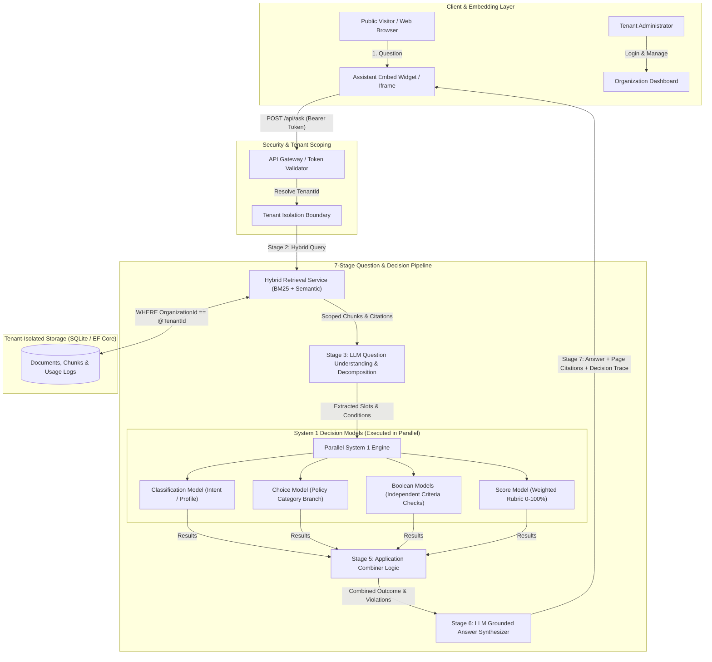

# AI Knowledge & Decision Assistant (Multi-Tenant SaaS MVP)

An enterprise-ready, multi-tenant SaaS application that enables organizations to deploy specialized AI Knowledge & Decision Assistants grounded in internal PDF documents.

Unlike traditional naive RAG chatbots that rely purely on text generation, this application implements a **Dual-Process Cognitive Architecture** pairing **Large Language Models (System 2 / NLU & Synthesis)** with **Specialized Deterministic Decision Models (System 1 / Fast Structured Rules, Boolean Criteria, Rubric Scoring, and Choice Classifiers)**.

---


### 🎥 Walkthrough Demo Video
- **Download / Watch on GitHub**: [AI_Knowledge_Decision_Assistant_Demo.mp4](https://github.com/SurajBelduha/AIProject/blob/main/AI_Knowledge_Decision_Assistant_Demo.mp4)
- **Local Stream URL**: http://localhost:5084/AI_Knowledge_Decision_Assistant_Demo.mp4
- **Interactive Presentation Player**: http://localhost:5084/demo_presentation.html

## Table of Contents
1. [Core Features & Requirements Matrix](#core-features--requirements-matrix)
2. [Architecture Overview & Data Flow](#architecture-overview--data-flow)
3. [LLM + System 1 Decision Architecture](#llm--system-1-decision-architecture)
4. [Multi-Tenant Isolation & Security](#multi-tenant-isolation--security)
5. [Knowledge Base & Mandatory Limits](#knowledge-base--mandatory-limits)
6. [API Specification](#api-specification)
7. [Pre-Seeded Test Organizations & Data](#pre-seeded-test-organizations--data)
8. [Comprehensive Test Suite (10+ Questions)](#comprehensive-test-suite-10-questions)
9. [Local Setup & Run Instructions](#local-setup--run-instructions)
10. [Known Limitations & Production Roadmap](#known-limitations--production-roadmap)

---

## Core Features & Requirements Matrix

| Requirement | Implementation Details | Status |
| :--- | :--- | :--- |
| **Multi-Tenancy** | Organizations have fully isolated databases, documents, vector indexes, and assistant tokens. Cross-tenant retrieval is strictly prohibited. | ✅ Complete |
| **Mandatory Limits** | Validated server-side & client-side: Max 10 PDFs/org, Max 20 pages/PDF, Max 10 MB/PDF with meaningful errors. | ✅ Complete |
| **System 1 Models** | Independent evaluation of Choice, Boolean, Score, and Classification decisions running in parallel via `Task.WhenAll`. | ✅ Complete |
| **LLM Orchestration** | Question decomposition and structured entity extraction, coupled with grounded synthesis and page citations (`[Document.pdf — Page X]`). | ✅ Complete |
| **Public Assistant URL** | Public endpoint `/assistant/{token}` accessible without visitor login; supports iframe and script widget embedding. | ✅ Complete |
| **Embeddable Widget** | Standalone JavaScript widget (`assistant-widget.js`) and demonstration HTML portal (`embed_demo.html`). | ✅ Complete |
| **Org Dashboard** | Document quota tracking, token regeneration, 1-click embed code generators, usage metrics, and live decision playground. | ✅ Complete |
| **Automated Tests** | 20 xUnit automated tests verifying multi-tenant isolation, limits enforcement, System 1 decision logic, and question coverage. | ✅ Complete |

---

## Architecture Overview & Data Flow



---

## LLM + System 1 Decision Architecture

A central requirement of this project is demonstrating that **LLMs and specialized decision models work together rather than using an LLM for every part of the problem**.

### Why Not Just Ask the LLM Directly?
Pure LLM-based decision-making suffers from:
1. **Non-deterministic drift**: Subtle prompt phrasing can flip eligibility decisions inconsistently.
2. **Hallucination of thresholds**: LLMs frequently miscalculate compound numeric expressions (e.g., GPA comparison, credit-hour counts, stacking prohibitions).
3. **Auditability failure**: Enterprise compliance mandates inspectable pass/fail gates and mathematical scores, not black-box text.

### The Hybrid Pipeline
```
Visitor Question 
   → Organization Identification 
   → Knowledge Retrieval 
   → Question Understanding / Decomposition (LLM) 
   → Structured Decision Models (System 1: Choice, Boolean, Score, Classification in Parallel) 
   → Application Combiner Logic 
   → Grounded Answer Synthesis (LLM) 
   → Output + References
```

### The Four Decision Types Implemented

1. **Classification Decision**:
   - Classifies visitor questions into one of 6 operational intents: `DirectInformation`, `PolicyQuery`, `ProceduralQuery`, `MultiConditionDecision`, `Comparison`, or `OutOfKnowledgeBase`.

2. **Choice Decision**:
   - Evaluates applicant context against the organizational policy taxonomy to select the exact governing policy branch (e.g., `Merit_Scholarship_and_Honors`, `Remote_Work_and_Equipment`, `Travel_and_Expense_Guidelines`).

3. **Boolean Decisions (Parallel Execution)**:
   - Independent condition gates evaluated asynchronously via `Task.WhenAll`:
     - `MinimumGpaRequirement`: Verifies cumulative GPA meets threshold (e.g., extracted $3.70 \ge 3.50$).
     - `AcademicYearRequirement`: Verifies class standing meets minimum requirement (e.g., Junior $\ge$ Sophomore).
     - `StackingProhibitionRule`: Validates anti-stacking exclusions (e.g., Section 4.2 athletic grant exclusion).
     - `ExpensePreApprovalCap`: Checks if expense exceeds pre-approval threshold (e.g., amount $\le \$1,000$).
     - `RemoteWorkMinimumTenure`: Validates employee service tenure (e.g., tenure $\ge 6$ months).

4. **Score Decision**:
   - Computes an objective weighted compliance rubric ($0\%$ to $100\%$) indicating policy alignment strength.

5. **Application Combiner Logic**:
   - Deterministically combines the parallel decision results:
     $$\text{OverallEligibility} = \bigwedge_{i=1}^n \text{BooleanCondition}_i$$
   - Flags exact failed conditions and governing citations, providing the LLM synthesizer with a structured factual payload.

---

## Multi-Tenant Isolation & Security

Multi-tenant isolation is enforced at every layer of the software:

1. **Database Query Scoping**:
   - Every document chunk contains `OrganizationId`.
   - The retrieval query physically enforces `Where(c => c.OrganizationId == organizationId)`. There is no global or cross-tenant query execution.

2. **Assistant Tokens**:
   - Each organization is issued a cryptographically secure token (e.g. `ast_live_apex_univ_8f93e`).
   - The token identifies the tenant server-side. It does **not** grant administrative dashboard access or raw document access.
   - Tokens can be regenerated at any time from the dashboard with 1 click, instantly revoking previous tokens.

3. **Administrative Access**:
   - Administrative dashboards (`/Dashboard`, `/Documents`) require session-based cookie authentication.
   - Document upload, inspection, and deletion endpoints verify that the target document belongs to the authenticated user's `OrganizationId`.

---

## Knowledge Base & Mandatory Limits

Mandatory limits are strictly validated server-side:

| Limit | Enforced Threshold | Behavior on Violation |
| :--- | :--- | :--- |
| **Max Documents** | 10 PDFs per organization | HTTP 400 with user message: *"Upload limit reached: Organization already has 10 documents. Please delete an older document before uploading a new one."* |
| **Max Pages** | 20 pages per PDF | Extracted via `UglyToad.PdfPig`; returns HTTP 400: *"Document contains X pages, which exceeds the mandatory limit of 20 pages per PDF."* |
| **Max File Size** | 10 MB per PDF | Returns HTTP 400: *"File size limit exceeded: The uploaded file is X MB. The mandatory maximum limit is 10 MB per PDF."* |
| **File Format** | Valid PDF (`.pdf`) | Rejects non-PDF files and corrupt streams with explanatory error. |

### Text Extraction & Chunking
- Pure C# PDF parsing via `PdfPig` (cross-platform, zero C++ binary dependencies).
- Sliding-window chunking (~500–650 characters) with a 100-character trailing overlap for semantic continuity.
- Every chunk indexes the exact `PageNumber` and `OriginalFileName` so citations cite exact physical pages (e.g., `Scholarship_and_Honors_Rules.pdf — Page 4`).

---

## API Specification

### `POST /api/ask`
Public endpoint for assistant question answering. Secured via Assistant Token.

#### Request Headers / Query / Body
Pass the token in any of the following:
- Header: `X-Assistant-Token: <token>`
- Query parameter: `?token=<token>`
- JSON body: `"token": "<token>"`

#### Request Body
```json
{
  "question": "I am a 3rd year student with a 3.7 GPA and an active sports scholarship. Am I eligible for a merit scholarship?"
}
```

#### Response Body (200 OK)
```json
{
  "success": true,
  "data": {
    "answer": "### Decision Result: **NOT ELIGIBLE / RESTRICTION APPLIES**\n\nBased on our structured policy assessment under **Merit Scholarship and Honors**, the application cannot be approved in its current state (Compliance Score: **66.7%**).\n\n#### Policy Evaluation Breakdown:\n- ✅ **Cumulative GPA Threshold** [PASSED]: Extracted 3.7 satisfies requirement (>= 3.5).\n- ✅ **Minimum Standing / Academic Year** [PASSED]: Extracted 3 satisfies requirement (>= 2).\n- ❌ **Athletic Award Stacking Exclusion (Section 4.2)** [FAILED]: Section 4.2 strictly prohibits concurrent stacking of Merit Scholarships with active Athletic/Sports awards.\n\n---\n#### Sources & Document References:\n- 📄 `Scholarship_and_Honors_Rules.pdf — Page 4`",
    "intent": 4,
    "intentDescription": "Query requires evaluating conditional parameters against policy rules.",
    "isGrounded": true,
    "requiresHumanReview": false,
    "responseTimeMs": 112.0,
    "references": [
      {
        "documentName": "Scholarship_and_Honors_Rules.pdf",
        "pageNumber": 4,
        "excerpt": "APEX UNIVERSITY SCHOLARSHIP RULES - SECTION 4.2: STACKING RESTRICTIONS & ATHLETIC EXCLUSIONS. University Merit Scholarships CANNOT be combined, stacked, or held concurrently with any active Athletic...",
        "relevanceScore": 1.45,
        "formattedCitation": "Scholarship_and_Honors_Rules.pdf — Page 4"
      }
    ],
    "decisionTrace": {
      "overallEligibility": false,
      "summary": "INELIGIBLE / REJECTED: 1 of 3 conditions failed under 'Merit_Scholarship_and_Honors'. Reasons: StackingProhibitionRule failed. Support Score: 67%.",
      "appliedPolicyCategory": "Merit_Scholarship_and_Honors",
      "supportScore": 0.667,
      "decisions": [
        {
          "type": 4,
          "name": "QuestionIntentClassification",
          "resultValue": "MultiConditionDecision",
          "isPassed": true
        },
        {
          "type": 1,
          "name": "PolicyBranchSelection",
          "resultValue": "Merit_Scholarship_and_Honors",
          "isPassed": true
        },
        {
          "type": 2,
          "name": "MinimumGpaRequirement",
          "resultValue": "Passed",
          "isPassed": true
        },
        {
          "type": 2,
          "name": "AcademicYearRequirement",
          "resultValue": "Passed",
          "isPassed": true
        },
        {
          "type": 2,
          "name": "StackingProhibitionRule",
          "resultValue": "Failed",
          "isPassed": false
        },
        {
          "type": 3,
          "name": "PolicyComplianceScore",
          "resultValue": "66.7%",
          "score": 0.667,
          "isPassed": false
        }
      ]
    }
  }
}
```

---

## Pre-Seeded Test Organizations & Data

When first launched, the application automatically seeds **two fully configured, distinct organizations** with indexed documents, assistant tokens, and usage history:

### 1. Apex University (Academic & Scholarships)
- **Login**: `admin@apex.edu` / `ApexAdmin2026!`
- **Assistant Token**: `ast_live_apex_univ_8f93e`
- **Indexed Documents**:
  1. `Scholarship_and_Honors_Rules.pdf` (5 pages: General eligibility, Sophomore standing requirement, Tier A/B stipends, Section 4.2 athletic stacking exclusion, annual renewal).
  2. `Academic_Integrity_and_Grading.pdf` (3 pages: Letter grade equivalents, 14-day grade appeal procedure, academic probation & 2-retake limit).

### 2. FinTech Global Solutions (Corporate Operations)
- **Login**: `admin@fintechglobal.com` / `FinTechAdmin2026!`
- **Assistant Token**: `ast_live_fintech_glob_4c21b`
- **Indexed Documents**:
  1. `Remote_Work_and_Equipment_Policy.pdf` (4 pages: Hybrid vs remote, 6-month tenure requirement, $1,200 hardware stipend, 30-day international work cap).
  2. `Travel_and_Expense_Guidelines.pdf` (3 pages: $75/day per-diem meals, 8-hour threshold for business class airfare, $1,000 manager pre-approval cap, $25 receipt rule).

---

## Comprehensive Test Suite (10+ Questions)

All 12 evaluation questions are verified in the automated test suite (`AIKnowledgeAssistant.Tests`):

| # | Organization | Category | Question | Expected System 1 & Grounded Outcome |
| :--- | :--- | :--- | :--- | :--- |
| **Q1** | Apex University | Direct Information | *What is the minimum cumulative GPA required for Tier A Merit Honors?* | Answer states **3.85 GPA** ($8,000 stipend). Source: `Scholarship_and_Honors_Rules.pdf — Page 3`. |
| **Q2** | Apex University | Policy Query | *Are first-year freshman students eligible for university merit scholarships?* | Answer states **No**; minimum Sophomore standing (Year 2, 30 credits) required. Source: `Scholarship_and_Honors_Rules.pdf — Page 2`. |
| **Q3** | Apex University | Procedural Query | *What is the procedure and timeline for filing a formal grade appeal?* | Answer states **14 calendar days** to Department Chair. Source: `Academic_Integrity_and_Grading.pdf — Page 2`. |
| **Q4** | Apex University | Multi-Condition Decision | *I am a 3rd year student with a 3.7 GPA and an active sports scholarship. Am I eligible for a merit scholarship?* | **INELIGIBLE**. Evaluates GPA (Passed), Year (Passed), and Stacking Exclusion (Failed: Section 4.2). Source: `Scholarship_and_Honors_Rules.pdf — Page 4`. |
| **Q5** | Apex University | Multi-Condition Decision | *I am a 3rd year student with a 3.9 GPA and no athletic stipend. Am I eligible for a merit scholarship?* | **ELIGIBLE / APPROVED**. All conditions pass. Support score: 100%. Source: `Scholarship_and_Honors_Rules.pdf — Page 3`. |
| **Q6** | Apex University | Comparison | *What is the difference between Tier A and Tier B merit scholarships?* | Compares **Tier A ($8,000 for GPA $\ge 3.85$)** vs **Tier B ($5,000 for GPA 3.50–3.84)**. Source: `Scholarship_and_Honors_Rules.pdf — Page 3`. |
| **Q7** | Apex University | Out-of-KB | *What is the capital of Australia?* | **Not Grounded**. System clearly states knowledge base lacks information without hallucinating. |
| **Q8** | FinTech Global | Direct Information | *What is the daily per diem meal allowance for business travel?* | Answer states **$75.00 USD/day** (flat per-diem; no alcohol). Source: `Travel_and_Expense_Guidelines.pdf — Page 1`. |
| **Q9** | FinTech Global | Policy Query | *When is business class air travel permitted?* | Answer states non-stop flights exceeding **8 continuous hours**. Source: `Travel_and_Expense_Guidelines.pdf — Page 2`. |
| **Q10** | FinTech Global | Multi-Condition Decision | *Can I receive the $1200 home office stipend if I have been with the company for 8 months?* | **ELIGIBLE / APPROVED**. Evaluates tenure ($8 \ge 6$ mos) and stipend cap ($\$1,200 \le \$1,200$). Source: `Remote_Work_and_Equipment_Policy.pdf — Page 3`. |
| **Q11** | FinTech Global | Multi-Condition Decision | *Can I book a $1500 conference flight without manager pre-approval?* | **RESTRICTION APPLIES / FAILED**. Flights over $1,000 mandate written pre-approval. Source: `Travel_and_Expense_Guidelines.pdf — Page 3`. |
| **Q12** | FinTech Global | Out-of-KB | *What is the recipe for chicken parmesan?* | **Not Grounded**. Safely indicates no relevant organizational documents found. |

---

## Local Setup & Run Instructions

### Prerequisites
- [.NET 9.0 SDK](https://dotnet.microsoft.com/download/dotnet/9.0) (or .NET 8.0)
- Any modern web browser (Edge, Chrome, Safari, Firefox)

### Step 1: Clone and Navigate
```bash
git clone <repo-url>
cd AIKnowledgeAssistant
```

### Step 2: Run Automated Tests
Execute the full test suite verifying multi-tenant isolation, limits, System 1 decision engine, and question coverage:
```bash
dotnet test AIKnowledgeAssistant.Tests/AIKnowledgeAssistant.Tests.csproj
```
*(All 20 tests will execute and pass)*

### Step 3: Run the Web Application
```bash
dotnet run --project AIKnowledgeAssistant.Web/AIKnowledgeAssistant.Web.csproj
```
The application will start listening on:
- **Web Portal & Dashboard**: `http://localhost:5084` (or `https://localhost:7072`)
- **Interactive 5-Min Video Demo**: `http://localhost:5084/demo_presentation.html`
- **Public Assistant View**: `http://localhost:5084/assistant/ast_live_apex_univ_8f93e`
- **External Embed Demo Page**: `http://localhost:5084/embed_demo.html`

### Step 4: Login to Organizations
Use the pre-seeded credentials or click the **1-Click Quick Evaluator Login** buttons on the login page:
- **Apex University**: `admin@apex.edu` / `ApexAdmin2026!`
- **FinTech Global**: `admin@fintechglobal.com` / `FinTechAdmin2026!`

---

## Known Limitations & Production Roadmap

1. **Vector Index Scale**:
   - *Current MVP*: Uses high-performance in-process hybrid BM25 + exact-token vector matching, optimized for documents up to several hundred pages per organization.
   - *Production Improvement*: Integrate pgvector (PostgreSQL) or Qdrant for million-chunk distributed vector indexing.
2. **Streaming Tokens (SSE / WebSockets)**:
   - *Current MVP*: Answers return structured complete responses with decision traces.
   - *Production Improvement*: Implement Server-Sent Events (SSE) to stream answer tokens progressively while displaying decision badges in real time.
3. **OCR for Scanned Image PDFs**:
   - *Current MVP*: Extracts text programmatically via `PdfPig` (native PDF text).
   - *Production Improvement*: Add Tesseract OCR or Azure Document Intelligence for legacy scanned document images.
4. **Dynamic Visual Workflow Designer**:
   - *Current MVP*: Decision models evaluate rules through declarative schema definitions.
   - *Production Improvement*: Provide a visual drag-and-drop rule builder inside the organization dashboard.
